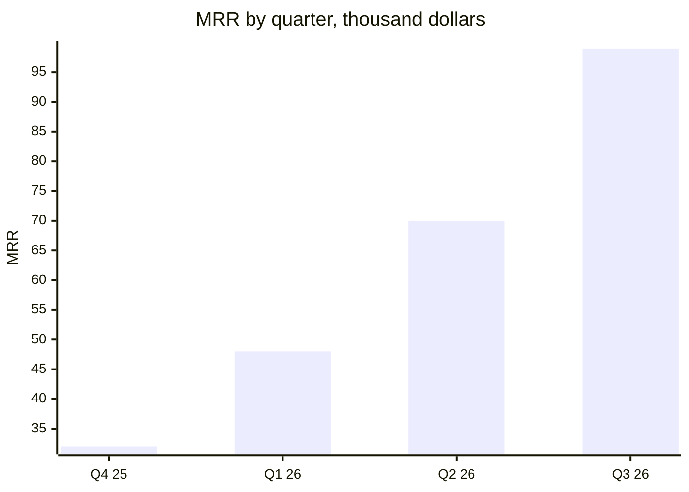

# Loomstack: stock that matches sales.
# Fashion brands sell out ==30% less== often.

Company one-pager, October 2026, for buyers at independent fashion brands and for investors. Loomstack is inventory planning software for brands selling online and in shops. Contact: Hana Sato, CEO, hana@loomstack.example.

## 01 · Problem
what it costs a brand today

> [!stats]
> - [!] **1 in 4** best sellers out of stock in peak season
> - [!] **22%** of stock sold at a discount at season end
> - **9 hours** a week planning orders in spreadsheets

> [!lineage] What brands tell us
> "We ran out of our best jacket in October and sold 400 of the wrong colour at half price in January." Founder of a 30-person outerwear brand, Portland.

## 02 · Solution
one plan for every shop and channel

> [!flow]
> - Connect Shopify and the till
> - Forecast each item and size
> - [x] Reorder in one click

> [!uc]
> - **Forecast by size** Sales history, season and weather, for every item, colour and size.
> - **Reorder list** What to order from which factory, and when, ready to send.
> - **Move stock** Which shop holds the stock another one will run out of.

## 03 · Traction
since launch in January 2025

> [!stats]
> - [x] **\$99K** MRR, up 3x since last December
> - [x] **148** brands paying
> - [x] **104%** net revenue retention
> - **2.1%** monthly logo churn

## 04 · Customers
brands with 10 to 200 staff, \$2M to \$50M in sales

> [!cards]
> - **Northfold** outerwear, 31 shops. Stockouts in peak season down from 24% to 9% in one winter.
> - **Ama Studio** knitwear, online only. End-of-season discounts down from 28% to 15% of stock.
> - **Tidal Supply** swimwear, 12 shops. Planning time from two days a week to half a day.

%% table accentCol=1 cols="1.6fr 1fr 1fr" %%
| Plan | Price a month | Brands |
| --- | --- | --- |
| Starter: one channel, 2,000 items | \$290 | 69 |
| Growth: every channel, shops | \$790 | 64 |
| Scale: factories and stock moves | \$1,900 | 15 |

## 05 · Team
fashion and data people

> [!uc]
> - **Hana Sato, CEO** Ran planning at a 200-shop clothing chain for eight years.
> - **Owen Pike, CTO** Built demand forecasting at a grocery delivery company.
> - **Rosa Lindqvist, sales** Sold to 300 fashion brands at a payments company.

**Team:** 14 people in Portland and Stockholm; 6 in engineering, 4 in sales and success.

## 06 · The ask
what we want from you

> [!lineage] For brands
> A 30-day trial on last year's data: we show what you would have run out of, and what you would have discounted. Book it at loomstack.example/trial.

> [!lineage] For investors
> We are raising a \$4M seed to open the UK and add factory ordering. \$1.5M is committed; the round closes November 30.
