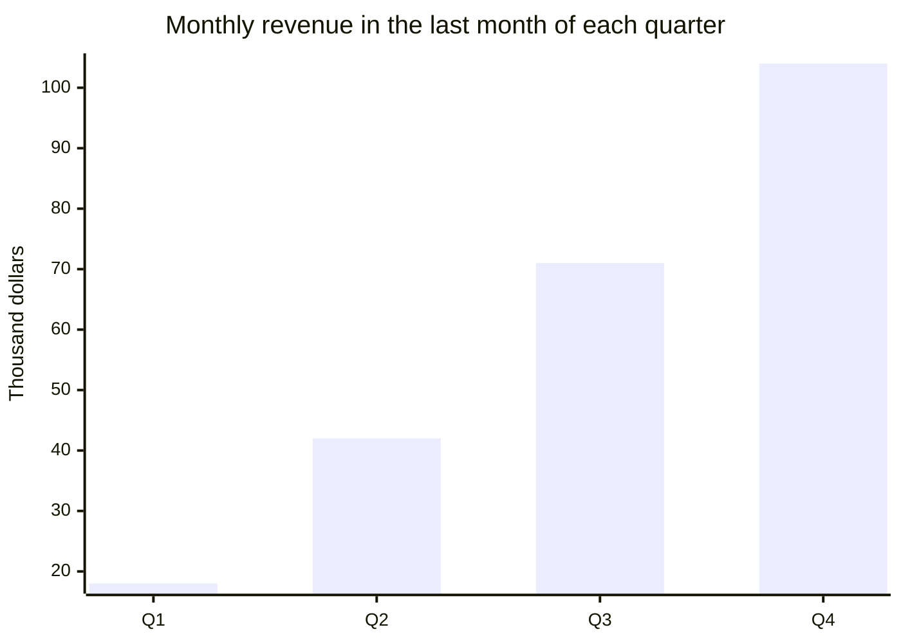
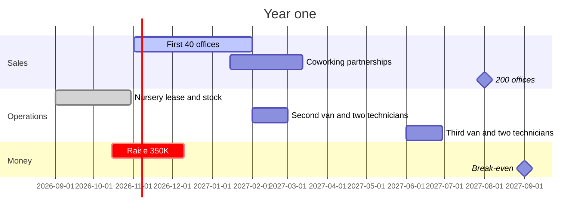
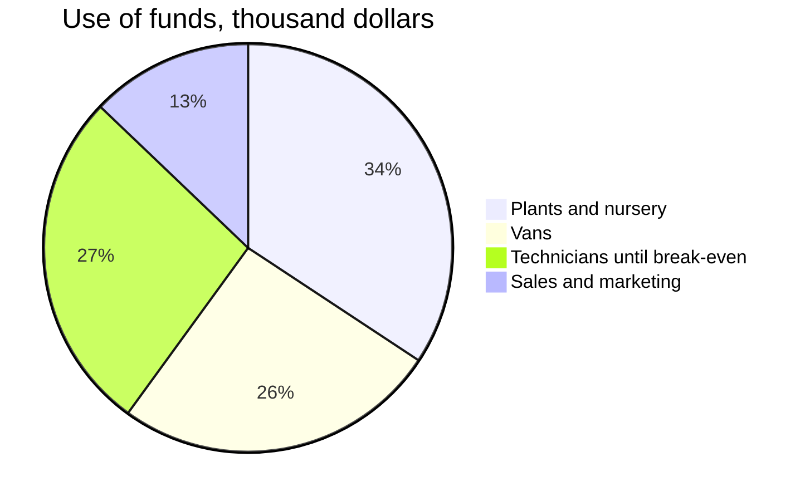

# Greenroom: office plants, cared for.
# ==\$1.2M ARR== in Austin within 12 months.

One-page business plan, October 2026, for the founders, our bank and two angel investors. Greenroom rents plants to offices and sends a technician every two weeks to water, prune and replace them. The lean canvas first, then the market, the money and the next 12 months.

## 01 · The business on one page
a lean canvas

> [!canvas]
> #### 2 · Problem %%p%%
> - Office plants die within months
> - Nobody's job is to water them
> - Buying and replacing is a hassle
> ##### Existing alternatives
> - Office managers buying at garden centres
> - Fake plants
>
> #### 4 · Solution %%s%%
> - Plants rented, not bought
> - A technician every two weeks
> - A dead plant replaced free in 48 hours
>
> #### 3 · Unique value proposition %%u%%
> - Living plants that stay alive, for a flat monthly fee
>
> #### 9 · Unfair advantage %%a%%
> - Our own nursery: plants cost us 40% less
>
> #### 1 · Customer segments %%c%%
> - Offices with 20–200 staff
> - Coworking spaces
> ##### Early adopters
> - Tech offices back to the office 3+ days a week
>
> #### 8 · Key metrics %%m%%
> - Offices signed a month
> - Plants per office
> - Monthly churn
>
> #### 5 · Channels %%h%%
> - Office managers' networks
> - Coworking partnerships
> - Facilities brokers
>
> #### 7 · Cost structure %%k%%
> - Technicians and vans
> - Nursery and plants
>
> #### 6 · Revenue streams %%r%%
> - \$9 per plant a month, 12-month contract
> - One-off event plants

## 02 · Market
Austin first, then Dallas and Houston

> [!stats]
> - **9,400** offices with 20–200 staff in Austin
> - **\$51M** a year if each rented 50 plants
> - [x] **\$4M** a year: our target, 8% of them by year three
> - **0** local rivals with their own nursery

> [!lineage] Why now
> Two thirds of Austin tech companies now ask staff in at least three days a week. Office managers are told to make offices worth the commute, and plants are the cheapest thing on their list.

## 03 · Revenue model
how a plant pays

%% table accentCol=1 cols="1.6fr 1fr 2fr" %%
| Per plant, a month | Amount | Note |
| --- | --- | --- |
| Price | \$9.00 | 12-month contract, billed monthly |
| Plant and pot, spread over 3 years | \$1.10 | from our own nursery |
| Technician time and van | \$3.40 | 30 plants an hour, two visits a month |
| Replacements | \$0.60 | 1 in 12 plants a year |
| Gross margin | \$3.90 | 43% |

**Break-even:** 9,500 plants under contract, about 190 offices of 50 plants, expected in September 2027.

## 04 · The next 12 months
milestones and money

### Use of the \$350K

1. **Sign 40 offices by February.** The three founders sell; every office manager we sign is asked for two intros.
2. **Hire four technicians.** Two in February, two in June, trained in our nursery for two weeks.
3. **Reach break-even by September.** Then decide between Dallas and Houston with a year of churn data.
