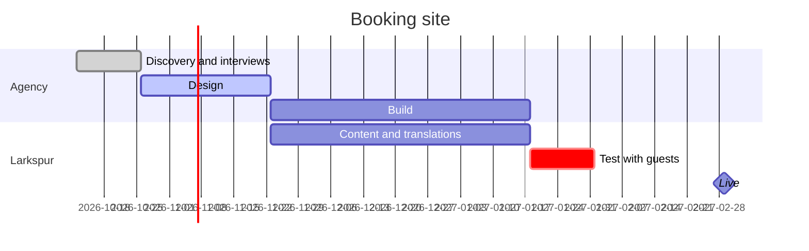
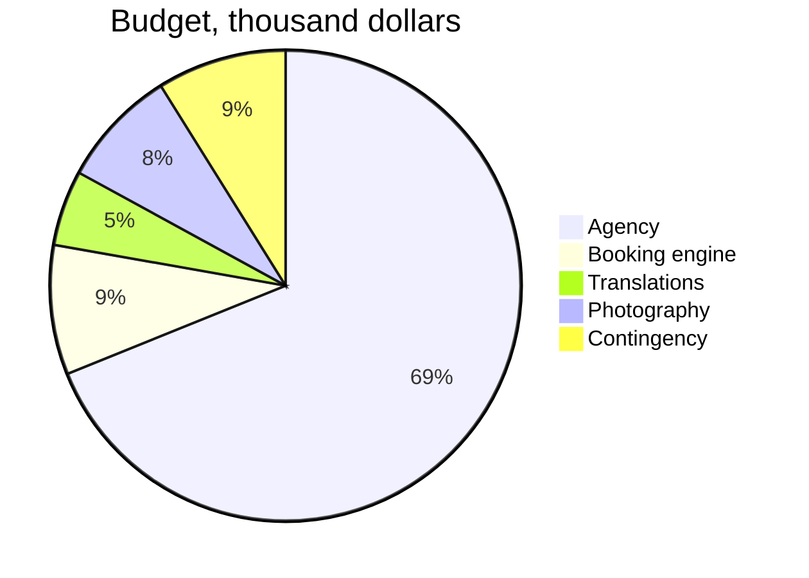

# A new booking site for Larkspur Hotels.
# Direct bookings to ==45%== by summer 2027.

Project brief, October 2026: the goal, what is in and out, who decides, the timeline, the budget and how we will know it worked. Larkspur runs nine boutique hotels in Portugal and Spain. Owner: Inês Duarte, head of digital. Reviewers comment and edit here; this page is the brief the agency quotes against.

## 01 · Goal
why this project, why now

> [!stats]
> - [!] **31%** of rooms booked direct, the rest through online travel agencies
> - [!] **18%** commission on every agency booking
> - **\$2.9M** paid in commission last year
> - [!] **1.2%** of mobile visits book, against 3.4% on desktop

> [!lineage] Why now
> Our booking engine contract ends in May 2027, and summer is 60% of the year's revenue. The new site must be live before the summer booking season starts in March.

**Done when:** a guest on a phone can find a room, see the full price and book it in under two minutes, in English, Portuguese, Spanish or French.

## 02 · Scope
what this project delivers, and what it does not

### In scope

> [!uc]
> - **New website** Nine hotel pages, offers, the group page; four languages.
> - **Booking engine** Search, room choice, extras and payment on our own domain.
> - **Member rate** 10% off for guests who sign up, shown next to the agency price.
> - **Content move** Photos, room texts and reviews from the old site.
> - **Analytics** Bookings tracked from first visit to payment, by channel.
> - **Training** Two sessions for the reservations team.

### Out of scope

> [!cards]
> - **Loyalty programme** Points and tiers come in a later project; the member rate is the first step.
> - **Mobile app** Guests book on the web; an app waits until direct bookings pass 50%.
> - **Restaurant and spa booking** They keep their own systems this year.

## 03 · Stakeholders
who decides, who does the work, who is told

%% table accentCol=1 cols="1.2fr 1.2fr 70px 2fr" %%
| Role | Who | RACI | What they need from the project |
| --- | --- | --- | --- |
| Sponsor | Tomás Reis, CEO | A | The budget held, and the summer date |
| Owner | Inês Duarte, head of digital | R | Weekly decisions on design and scope |
| Agency | Oakline Studio | R | Content, answers in two working days |
| Revenue | Clara Mendes, revenue manager | C | Rates and offers right on day one |
| Hotel managers | nine managers | C | Their hotel's page reviewed in one pass |
| Reservations team | 12 agents | I | Training before launch |

## 04 · Timeline
five phases, live by March 1

> [!flow]
> - Discovery
> - Design
> - Build
> - Content and test
> - [x] Live by March 1

## 05 · Budget
fixed price from the agency, plus our own costs

%% table accentCol=1 cols="1.8fr 1fr 2fr" %%
| Item | Cost | Note |
| --- | --- | --- |
| Agency: design and build | \$186K | fixed price, three payments |
| Booking engine licence | \$24K | first year; was \$38K for the old one |
| Translations | \$14K | three languages, about 60,000 words |
| Photography | \$22K | nine hotels, two days each |
| Contingency | \$24K | 10%, released by the sponsor |
| Total | \$270K | paid back within the first summer at the target |

## 06 · Success metrics
measured monthly from launch, against last year

%% table accentCol=2 cols="1.6fr 1fr 1fr 1fr" %%
| Metric | Today | Target | By |
| --- | --- | --- | --- |
| Share of rooms booked direct | 31% | 45% | August 2027 |
| Mobile visits that book | 1.2% | 2.5% | June 2027 |
| Commission paid a month, in season | \$410K | \$300K | August 2027 |
| Guests who join for the member rate | none | 8,000 | August 2027 |

**Next step:** sponsor sign-off on this brief by October 16; the agency's kickoff the week after.
