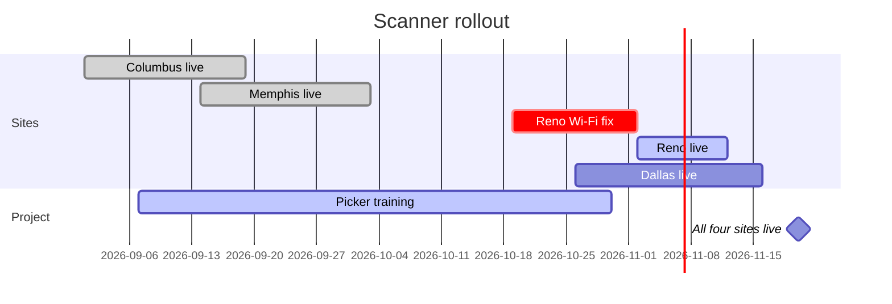
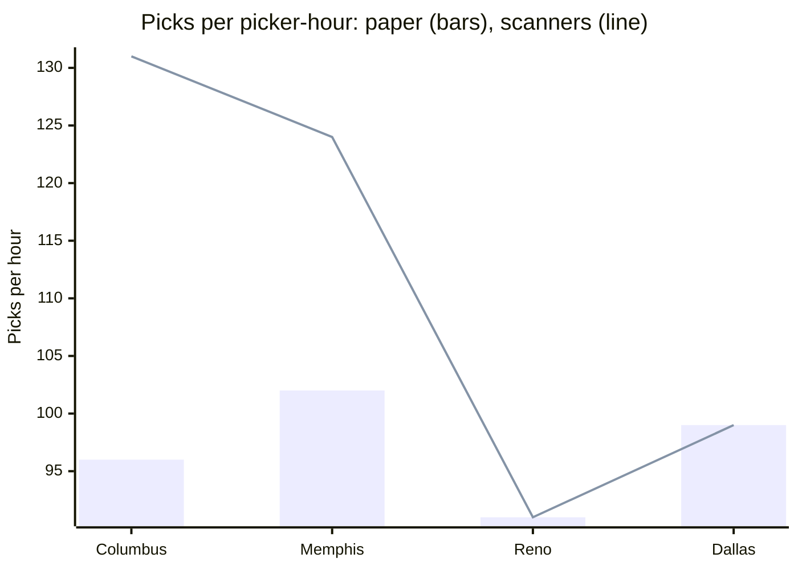

# Scanner rollout, status at week 6 of 14.
# Overall ==amber==: on budget, two weeks late at Reno.

Weekly status report to the steering group, October 9, 2026. Kestrel Logistics is replacing paper pick lists with handheld scanners in its four warehouses. Project lead: Maya Okafor. Next report: October 16.

## 01 · Status at a glance
green on track, amber at risk, red off track

> [!stats]
> - [!] **Amber** overall, green last week
> - [x] **2 of 4** warehouses live
> - **\$412K** spent of a \$680K budget
> - [!] **Nov 20** last go-live, the plan was Nov 6

%% table cols="1fr 110px 2.4fr" pillCol=1 %%
| Area | Status | Why |
| --- | --- | --- |
| Scope | yes | No change since kickoff: four sites, pick and pack only |
| Schedule | at risk | Reno's Wi-Fi survey found dead zones in aisles 30–44; two weeks to fix |
| Budget | yes | 61% spent at 43% of the timeline, as planned: hardware was paid up front |
| People | yes | 212 of 340 pickers trained; the rest are booked by October 30 |
| Vendor | no | The last 90 scanners are held at customs; no release date yet |

> [!lineage] What changed since last week
> Schedule went from green to amber. Reno needs eight more Wi-Fi access points before scanners work in every aisle. The installer starts October 19.

## 02 · Milestones
plan against forecast

%% table cols="1.4fr 1fr 1fr 110px" pillCol=3 %%
| Milestone | Plan | Forecast | On date |
| --- | --- | --- | --- |
| Columbus live | Sep 19 | done Sep 18 | yes |
| Memphis live | Oct 3 | done Oct 2 | yes |
| Reno live | Oct 23 | Nov 13 | no |
| Dallas live | Nov 6 | Nov 13 | at risk |
| Paper pick lists retired | Nov 13 | Nov 20 | at risk |

### Picks per hour, paper against scanners

**Reading it:** the two live sites pick 22–36% faster with scanners. Reno and Dallas are still on paper, so their line meets the bar.

## 03 · Risks and issues
what could hurt the date, and what already does

%% table cols="1.6fr 100px 1fr 120px" pillCol=3 %%
| Risk or issue | Impact | Owner | Contained |
| --- | --- | --- | --- |
| Issue: 90 scanners held at customs | high | Dev, procurement | no |
| Issue: Reno Wi-Fi dead zones | high | Ana, IT | yes, but late |
| Risk: Dallas peak season starts Nov 16 | high | Maya | yes, but tight |
| Risk: night shift trained last | medium | Leo, operations | yes |
| Risk: label printer driver on old Windows | low | Ana, IT | yes |

## 04 · Decisions needed
from the steering group by October 14

> [!lineage] The question
> If the held scanners are not released by October 20, Dallas cannot go live before its peak season. Moving it to January avoids changing a warehouse mid-peak but keeps paper there for two more months.

> [!cards]
> - **A · Lease 90 scanners** \$18K for three months, from the same vendor. Dallas goes live November 13 as planned.
> - **B · Move Dallas to January** No extra cost. Dallas stays on paper through peak season; the project ends January 22.
> - **C · Split Dallas** Day shift on scanners now, night shift in January. Cheaper than A, but two ways of working in one building.

**Our recommendation:** A. The \$18K comes out of the \$40K contingency, and faster picking at Dallas pays it back in about five weeks.

### Next week

1. **Reno.** The Wi-Fi installer on site from October 19; a survey of every aisle after.
2. **Training.** The last 128 pickers, night shift first.
3. **Customs.** Daily calls with the broker until the 90 scanners are released.
