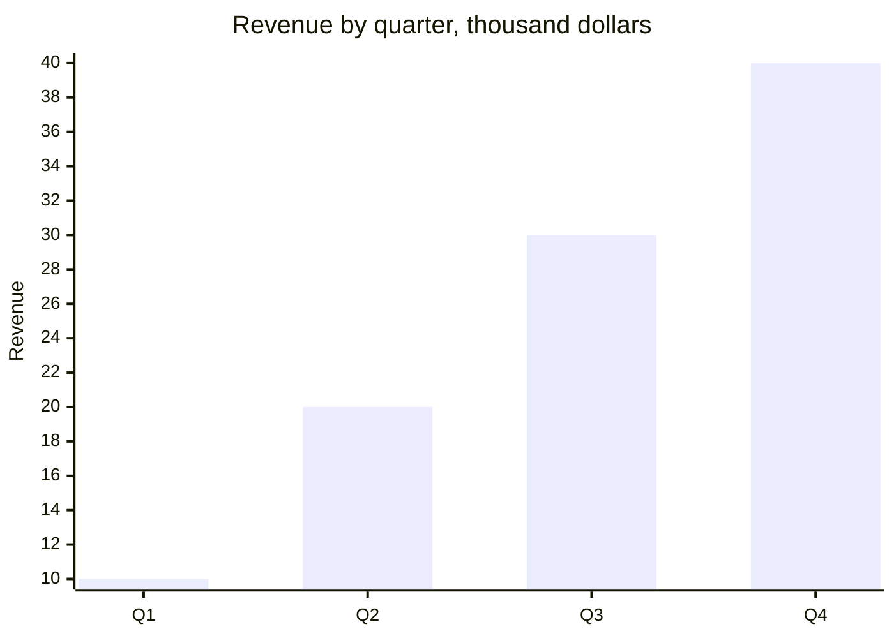

# [Company]: [what you do, in five words].
# [Customers] get ==[the main result]==.

Company one-pager, [month year], for [customers, partners, investors]. What the company sells and to whom, in one sentence. Contact: [name, title, email].

## 01 · Problem
what it costs the customer today

> [!stats]
> - [!] **0** how often the problem happens
> - [!] **0%** what it costs in money or lost sales
> - **0 hours** the time it eats

> [!lineage] What customers tell us
> One real quote, and who said it.

## 02 · Solution
how it works

> [!flow]
> - First step
> - Second step
> - [x] The result

> [!uc]
> - **A feature** What it does for the customer.
> - **Another feature** What it does.
> - **Another feature** What it does.

## 03 · Traction
since [launch date]

> [!stats]
> - [x] **\$0** revenue or MRR, and the growth
> - [x] **0** paying customers
> - [x] **0%** retention, or another proof that they stay
> - **0%** churn

## 04 · Customers
who buys, and what they got

> [!cards]
> - **[Customer]** what kind of company. The result, with a number.
> - **[Customer]** what kind of company. The result, with a number.
> - **[Customer]** what kind of company. The result, with a number.

%% table accentCol=1 cols="1.6fr 1fr 1fr" %%
| Plan | Price a month | Customers |
| --- | --- | --- |
| [Plan]: what it includes | \$0 | 0 |
| [Plan]: what it includes | \$0 | 0 |

## 05 · Team
why you are the people to do it

> [!uc]
> - **[Name], CEO** What they did before that matters here.
> - **[Name], CTO** What they did before.
> - **[Name], [role]** What they did before.

**Team:** how many people, where, and in what roles.

## 06 · The ask
what you want from the reader

> [!lineage] For customers
> The next step: a trial, a demo, a call, and how to book it.

> [!lineage] For investors
> How much you raise, for what, how much is committed, and when it closes.
