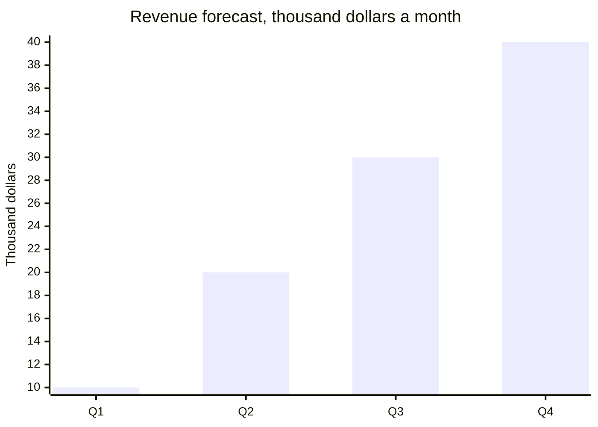
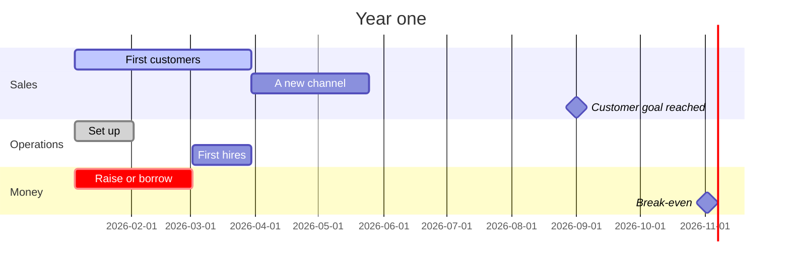
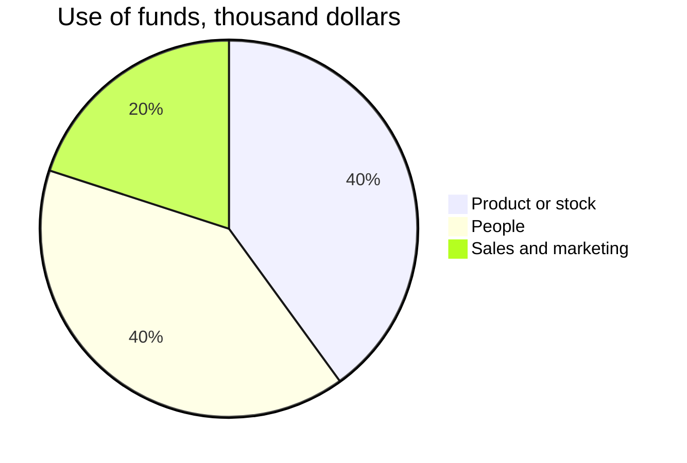

# [Company]: [what you do, in five words].
# ==[The goal]== within [N] months.

One-page business plan, [month year], for [the founders, a bank, investors]. What the company sells, to whom, and how, in two sentences. The lean canvas first, then the market, the money and the next 12 months.

## 01 · The business on one page
a lean canvas: fill the boxes in their numbered order

> [!canvas]
> #### 2 · Problem %%p%%
> - The top one to three problems customers have
> ##### Existing alternatives
> - How they solve them today
>
> #### 4 · Solution %%s%%
> - What you do about each problem
>
> #### 3 · Unique value proposition %%u%%
> - Why you are different and worth buying, in one sentence
>
> #### 9 · Unfair advantage %%a%%
> - What a rival cannot easily copy or buy
>
> #### 1 · Customer segments %%c%%
> - Who the customers are
> ##### Early adopters
> - Who buys first
>
> #### 8 · Key metrics %%m%%
> - The numbers that show it works
>
> #### 5 · Channels %%h%%
> - How customers find you
>
> #### 7 · Cost structure %%k%%
> - What costs the most
>
> #### 6 · Revenue streams %%r%%
> - What you charge, and for what

## 02 · Market
where you start, and where you go next

> [!stats]
> - **0** customers who could buy, where you start
> - **\$0** a year if all of them bought
> - [x] **\$0** a year: your target, and the share it is
> - **0** direct rivals there

> [!lineage] Why now
> What changed that makes this the right moment: a habit, a law, a price, a technology.

## 03 · Revenue model
how one sale pays

%% table accentCol=1 cols="1.6fr 1fr 2fr" %%
| Per [unit], a month | Amount | Note |
| --- | --- | --- |
| Price | \$0 | contract length, billing |
| [Main direct cost] | \$0 | what drives it |
| [Second direct cost] | \$0 | what drives it |
| Gross margin | \$0 | and as a percentage |

**Break-even:** how many customers or units, and when you expect it.

## 04 · The next 12 months
milestones and money

### Use of the money

1. **A sales goal.** How many customers, by when, and how you will reach them.
2. **A hiring or operations goal.** Who, when.
3. **A money goal.** Break-even, a raise or a loan, and the date.
