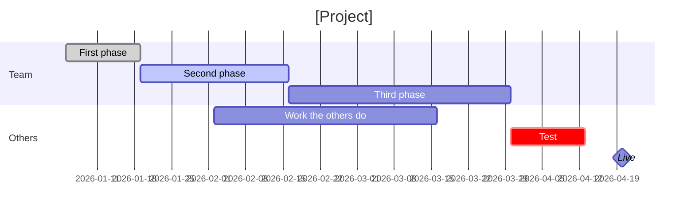
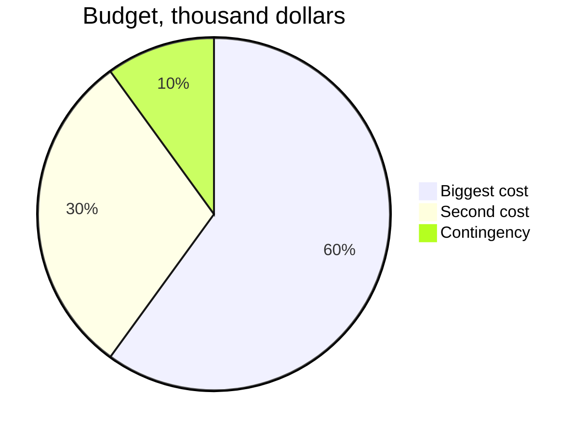

# [Project] for [team or company].
# [The outcome] ==[target]== by [date].

Project brief, [month year]: the goal, what is in and out, who decides, the timeline, the budget and how we will know it worked. Who the company is in one line. Owner: [name, role]. Reviewers comment and edit here; this page is the brief.

## 01 · Goal
why this project, why now

> [!stats]
> - [!] **0%** the number the project should move, today
> - [!] **\$0** what the problem costs
> - **0** a number that shows its size
> - [!] **0%** a number that shows where it hurts most

> [!lineage] Why now
> The deadline or the change that makes this project urgent.

**Done when:** what a user or customer can do at the end, in one sentence.

## 02 · Scope
what this project delivers, and what it does not

### In scope

> [!uc]
> - **A deliverable** What it is, in one line.
> - **Another deliverable** What it is.
> - **Another deliverable** What it is.

### Out of scope

> [!cards]
> - **Not this** Why it is out, and when it might come.
> - **Not that** Why it is out.

## 03 · Stakeholders
who decides, who does the work, who is told

%% table accentCol=1 cols="1.2fr 1.2fr 70px 2fr" %%
| Role | Who | RACI | What they need from the project |
| --- | --- | --- | --- |
| Sponsor | [name, title] | A | A is accountable: one person signs off |
| Owner | [name, title] | R | R is responsible: does the work |
| [Expert or team] | [name] | C | C is consulted before decisions |
| [Team affected] | [name] | I | I is informed after decisions |

## 04 · Timeline
phases and the end date

> [!flow]
> - First phase
> - Second phase
> - Third phase
> - [x] Live by [date]

## 05 · Budget
what it costs, and who pays

%% table accentCol=1 cols="1.8fr 1fr 2fr" %%
| Item | Cost | Note |
| --- | --- | --- |
| [Biggest cost] | \$0 | fixed price or estimate |
| [Second cost] | \$0 | what it covers |
| Contingency | \$0 | usually 10%, and who releases it |
| Total | \$0 | and how fast it pays back |

## 06 · Success metrics
measured how often, against what

%% table accentCol=2 cols="1.6fr 1fr 1fr 1fr" %%
| Metric | Today | Target | By |
| --- | --- | --- | --- |
| [The goal's number] | 0% | 0% | [date] |
| [A cost number] | \$0 | \$0 | [date] |
| [An adoption number] | 0 | 0 | [date] |

**Next step:** who signs off on this brief, by when, and what starts after.
