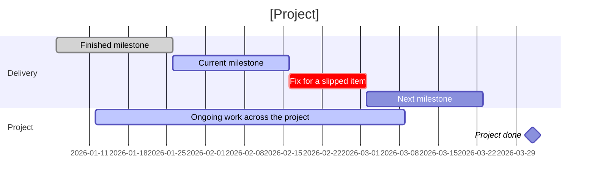
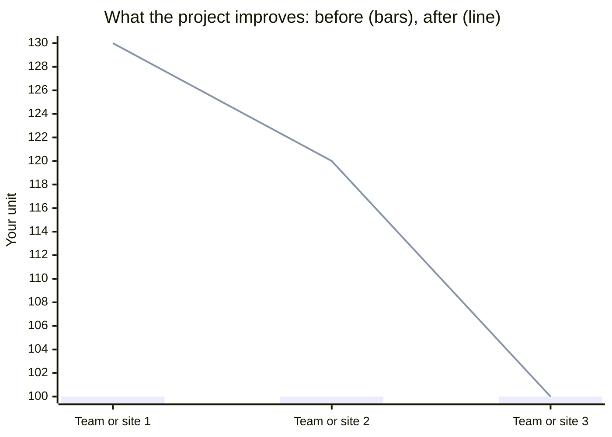

# [Project], status at week [N] of [N].
# Overall ==[green, amber or red]==: [the one-line reason].

Status report to [the steering group or sponsor], [date]. What the project delivers in one line. Project lead: [name]. Next report: [date].

## 01 · Status at a glance
green on track, amber at risk, red off track

> [!stats]
> - [!] **Amber** overall, and what it was last report
> - [x] **0 of 0** milestones or sites done
> - **\$0** spent of a \$0 budget
> - [!] **[Date]** the end date forecast, and the plan

%% table cols="1fr 110px 2.4fr" pillCol=1 %%
| Area | Status | Why |
| --- | --- | --- |
| Scope | yes | yes is green: what is in, and any change since the last report |
| Schedule | at risk | anything but yes or no is amber: what slipped, and by how much |
| Budget | yes | spent against the share of the timeline gone |
| People | yes | who is missing, who is overloaded |
| Vendor | no | no is red: what a supplier owes you, and since when |

> [!lineage] What changed since the last report
> The one status that moved, why, and what happens next.

## 02 · Milestones
plan against forecast

%% table cols="1.4fr 1fr 1fr 110px" pillCol=3 %%
| Milestone | Plan | Forecast | On date |
| --- | --- | --- | --- |
| [Done milestone] | [date] | done [date] | yes |
| [Late milestone] | [date] | [new date] | no |
| [Milestone at risk] | [date] | [date] | at risk |

### A number that shows progress

**Reading it:** what the chart shows, in one sentence.

## 03 · Risks and issues
what could hurt the date, and what already does

%% table cols="1.6fr 100px 1fr 120px" pillCol=3 %%
| Risk or issue | Impact | Owner | Contained |
| --- | --- | --- | --- |
| Issue: [something that has happened] | high | [name] | no |
| Risk: [something that might happen] | medium | [name] | yes, but [what is left] |
| Risk: [a smaller one] | low | [name] | yes |

## 04 · Decisions needed
from [whom] by [date]

> [!lineage] The question
> The decision in one or two sentences, and what happens if nobody makes it.

> [!cards]
> - **A · First option** What it costs and what it does to the date.
> - **B · Second option** What it costs and what it does to the date.
> - **C · Third option** Or leave it out if there are two.

**Our recommendation:** the option, and the one reason for it.

### Next week

1. **The most important task.** Who does it, by when.
2. **The next task.** Who does it, by when.
3. **A risk to watch.** What you will do about it.
